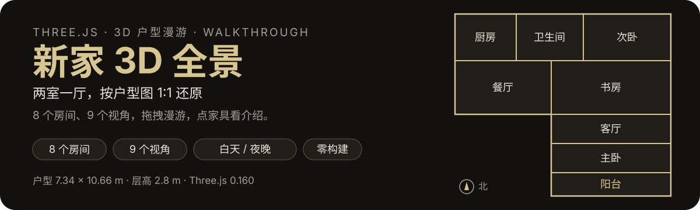
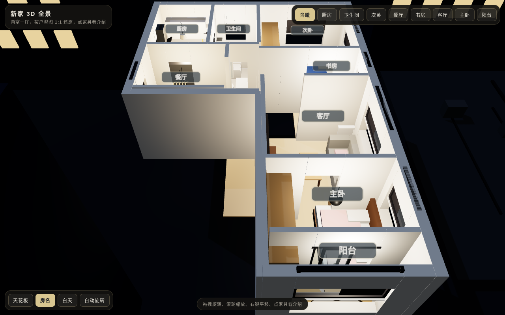
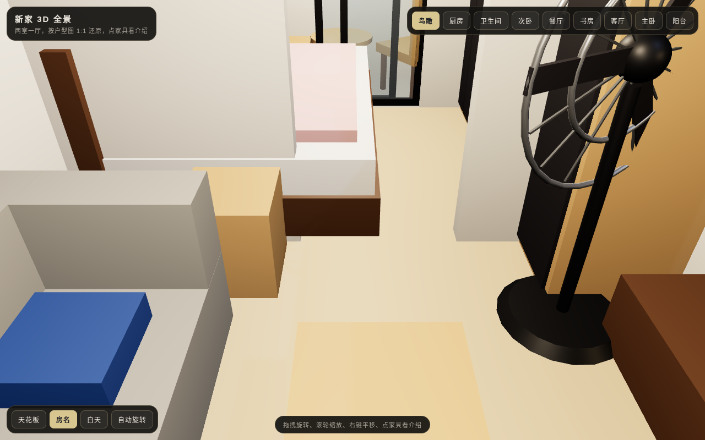

<p align="right"><a href="README.md">中文</a></p>

<p align="center">
  
</p>

<p align="center">
  <a href="https://holynova.github.io/apartment-3d/">▶ Walkthrough Online</a>
  ·
  <a href="https://github.com/holynova/apartment-3d">GitHub Repository</a>
</p>

Apartment 3D is a two-bedroom apartment in Three.js, rebuilt 1:1 from the floor plan and a walkthrough video: 7.34 × 10.66 m, 2.8 m ceilings, 8 rooms, 50 clickable items with short descriptions. Orbit, zoom, jump between 9 camera views, toggle day / night. Zero build, pure JavaScript + Three.js.

## Screenshots

<p align="center">
  
  <br>
  
</p>

## Features

- **1:1 floor plan**: modeled to the plan's dimensions (7.34 × 10.66 m, 2.8 m ceilings), walls with door and window openings, a hideable L-shaped ceiling; furniture placed as in the video, true to size (dining table 1400×700, bed 2100×1500, desk 1910×550).
- **8 rooms**: 厨房 Kitchen, 卫生间 Bathroom, 次卧 Second Bedroom, 餐厅 Dining Room, 书房 Study, 客厅 Living Room, 主卧 Master Bedroom, 阳台 Balcony — each with a toggleable name label.
- **9 camera views**: a bird's-eye view plus one per room, with smooth fly-to transitions; deep-linkable via URL parameters, e.g. `?view=餐厅&instant=1`.
- **50 clickable items**: windows, doors, furniture and appliances each carry a name and a one-line note — 双槽水槽 double sink, 侧吸油烟机 range hood, 波浪吊灯 wavy pendant lamp, 工业风扇 industrial fan, 裙楼屋顶 the podium rooftop… click one to pop up a card.
- **Day / night**: defaults to a warm evening (matching the video); one toggle switches to daylight and turns the room lights off.
- **Controls**: drag to orbit, scroll to zoom, right-drag to pan; touch: one finger to orbit, pinch to zoom. Auto-rotate toggle included.
- **Outdoor atmosphere**: ground, neighboring building silhouettes with lit windows, the podium rooftop outside the master window, and lights at night.

## Run Locally

Zero build — serve it statically (ES modules need http(s); don't open with `file://` directly):

```bash
python3 -m http.server 8000
# Open http://localhost:8000
```

## Tech

- Three.js 0.160 (CDN import map) + OrbitControls, PCF soft shadows; all geometry is generated in code (Box / Cylinder + a wall function with openings) — no external model files.
- Clickable items use Raycaster picking on registered parts (`reg()`, 50 items); room labels are Canvas-texture Sprites; view switching is an eased camera tween.
- Mobile-friendly: the view bar scrolls horizontally on small screens, and hints switch to touch gestures.

```
index.html          Entry: view buttons / four toggles / info cards / control hints
app.js              All logic (~700 lines): building shell / furniture in 8 rooms / lighting / views / clickable items
app.js.bak          Backup of app.js
```
