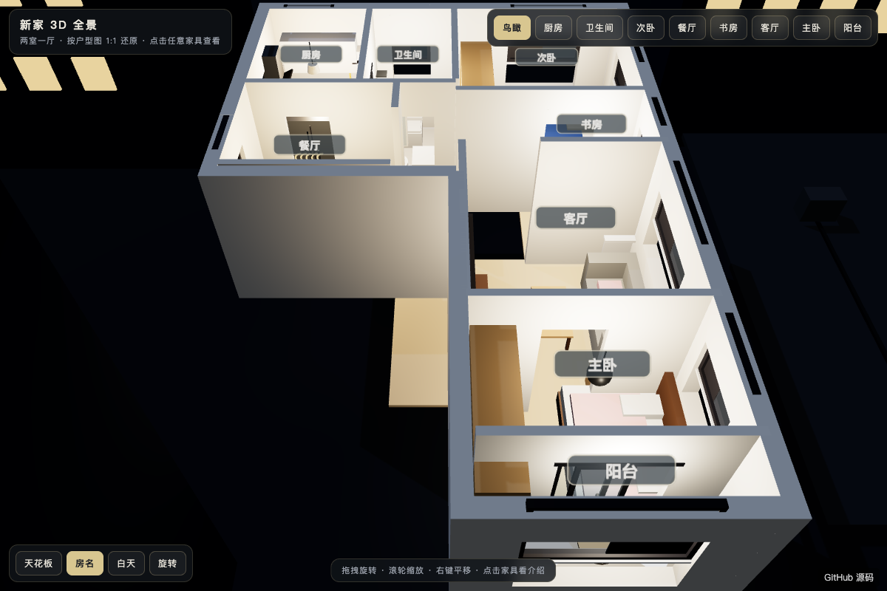

# Apartment 3D / 新家 3D 全景导览

中文：基于 Three.js 制作的两室一厅户型 3D 全景立体空间导览。还原入户、客厅、餐厅、主卧、次卧、厨房与阳台，支持全景鸟瞰、各房间视角漫游切换、日夜光照模式与点击空间交互。

English: Interactive 3D walk-through of a two-bedroom apartment built with Three.js. Features bird-eye floor plan view, room-by-room viewpoint navigation, day/night lighting toggles, and interactive spatial annotations.



## 在线体验 / Live Demo

- [Cloudflare Demo](https://xiaosang.cc/apartment-3d/)
- [GitHub Repo](https://github.com/holynova/apartment-3d)


## 本地运行 / Run locally

```bash
python3 -m http.server 8000
```

## 发布 / Deploy

```bash
npx wrangler deploy --config wrangler.jsonc
```

Cloudflare Workers · Domain: `xiaosang.cc` · Route: `/apartment-3d/`

源码与部署配置使用同一个主分支（main）；在本地手动发布，不创建 Cloudflare 专用分支或 GitHub Action。
