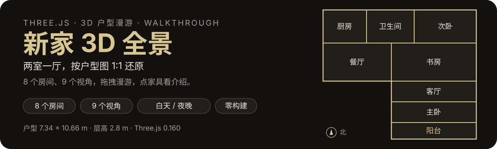
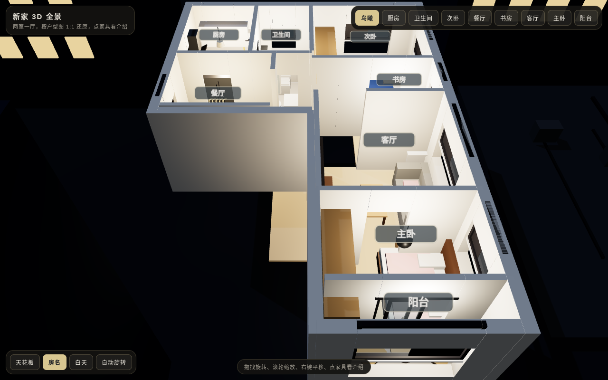
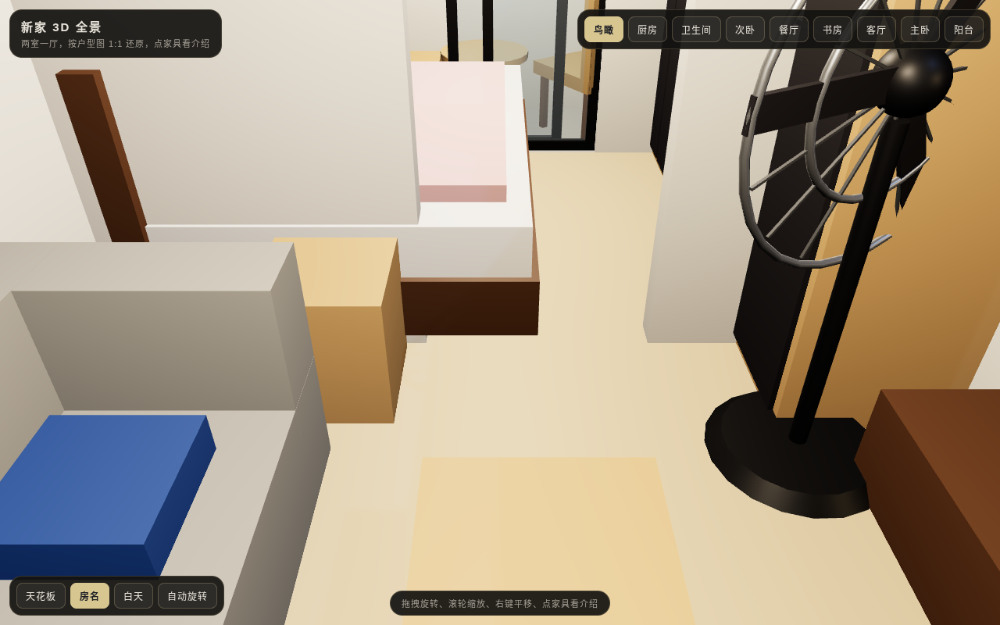

<p align="center">
  
</p>

<p align="center">
  <a href="https://holynova.github.io/apartment-3d/">▶ 在线漫游 Walkthrough Online</a>
  ·
  <a href="https://github.com/holynova/apartment-3d">GitHub 仓库</a>
</p>

新家 3D 全景是一套两室一厅的 Three.js 户型漫游：按户型图与实拍视频 1:1 还原，户型 7.34 × 10.66 米、层高 2.8 米，8 个房间、50 处家具家电都可点击查看介绍。拖拽旋转、滚轮缩放，一键切换 9 个视角与白天 / 夜晚。零构建，纯 JS + Three.js。

A two-bedroom apartment in Three.js, rebuilt 1:1 from the floor plan and a walkthrough video: 7.34 × 10.66 m, 2.8 m ceilings, 8 rooms, 50 clickable items with short descriptions. Orbit, zoom, jump between 9 camera views, toggle day / night. Zero build, pure JavaScript + Three.js.

## 截图 / Screenshots

<p align="center">
  
  <br>
  
</p>

## 功能 / Features

- **1:1 户型还原**：按户型图尺寸建模（7.34 × 10.66 m，层高 2.8 m），墙体带门窗洞口，L 形天花板可隐藏；家具按实拍摆放，尺寸写实（餐桌 1400×700、床 2100×1500、书桌 1910×550）。
- **8 个房间**：厨房、卫生间、次卧、餐厅、书房、客厅、主卧、阳台，各有房名标签（可开关）。
- **9 个视角**：鸟瞰 + 每个房间一个机位，点击按钮相机平滑飞过去；也支持 URL 参数直达，如 `?view=餐厅&instant=1`。
- **50 处点击介绍**：窗、门、家具、家电都有名字与一句介绍——双槽水槽、侧吸油烟机、波浪吊灯、工业风扇、裙楼屋顶……点一下弹出卡片。
- **白天 / 夜晚**：默认傍晚暖光（实拍是傍晚），一键切白天：天光变亮、室内灯灭。
- **漫游操作**：拖拽旋转、滚轮缩放、右键平移；移动端一指旋转、双指缩放；另有自动旋转开关。
- **室外氛围**：地面、邻楼剪影与亮窗、主卧窗外的裙楼屋顶，夜景有灯光。

## 本地运行 / Run Locally

零构建，直接起一个静态服务器打开即可（ES Module 需经 http(s)，不要用 `file://` 直接打开）：

```bash
python3 -m http.server 8000
# 打开 http://localhost:8000
```

## 技术 / Tech

- Three.js 0.160（CDN import map）+ OrbitControls，PCF 软阴影；全部几何体由代码生成（Box / Cylinder + 带洞口的墙体函数），无外部模型文件。
- 点击介绍用 Raycaster 拾取注册部件（`reg()`，50 处）；房名标签是 Canvas 纹理 Sprite；视角切换是缓动相机补间。
- 移动端适配：小屏视角条横滑、提示文案切换为触屏操作。

```
index.html          入口：视角按钮 / 四个开关 / 介绍卡片 / 操作提示
app.js              全部逻辑（约 700 行）：建筑外壳 / 8 个房间家具 / 灯光 / 视角 / 点击介绍
app.js.bak          app.js 的备份
```

## English

**Apartment 3D** is a two-bedroom apartment rebuilt in Three.js from the floor plan and a walkthrough video — 7.34 × 10.66 m, 2.8 m ceilings, true to scale.

- **8 rooms**: kitchen, bathroom, second bedroom, dining room, study, living room, master bedroom, balcony — each with a toggleable name label.
- **9 camera views**: a bird's-eye view plus one per room, with smooth fly-to transitions; deep-linkable via `?view=餐厅&instant=1`.
- **50 clickable items**: windows, doors, furniture and appliances each carry a name and a one-line note (double sink, range hood, wavy pendant lamp, industrial fan, the rooftop outside the master window…).
- **Day / night**: defaults to a warm evening (matching the video); one toggle switches to daylight and turns the room lights off.
- **Controls**: drag to orbit, scroll to zoom, right-drag to pan; touch: one finger to orbit, pinch to zoom. Auto-rotate toggle included.
- **Run it**: serve statically (`python3 -m http.server 8000`) — ES modules need http(s), not `file://`.
- **Tech**: Three.js 0.160 via CDN import map, OrbitControls, PCF soft shadows. All geometry is generated in code — no external model files.
